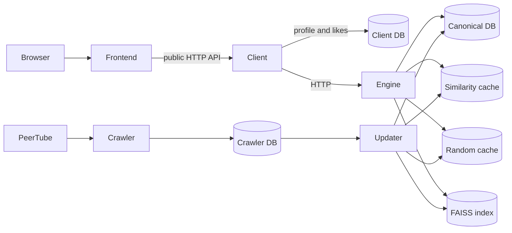
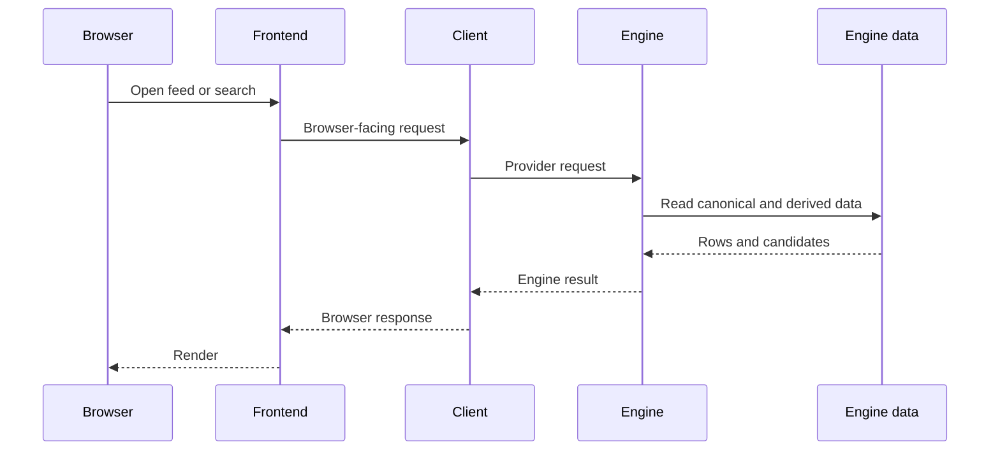
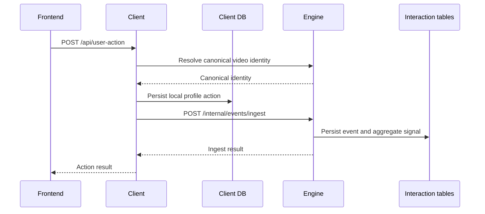
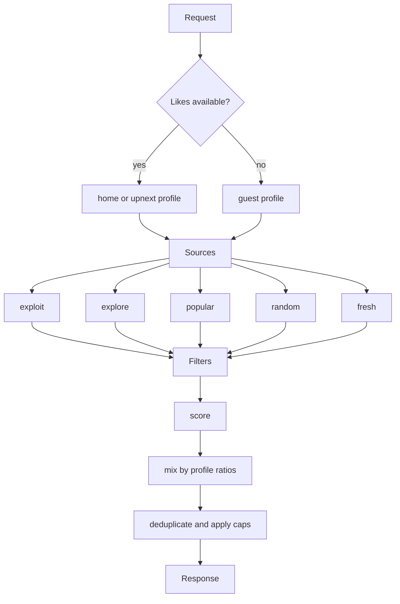
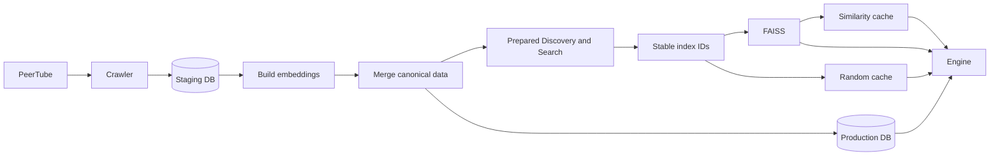
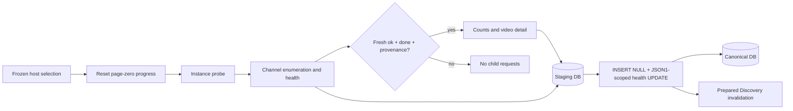

# Architecture Diagrams

Purpose: show the system structure and its main data and request flows.

## System

## Discovery Request

## User Action

## Recommendations

## Data Refresh

## Parent Lifecycle and Publication

A confirmed local network outage prevents new work across all active host queues; previously started operations drain before staging closes. The canonical Engine side independently filters videos with explicit parent health errors.
